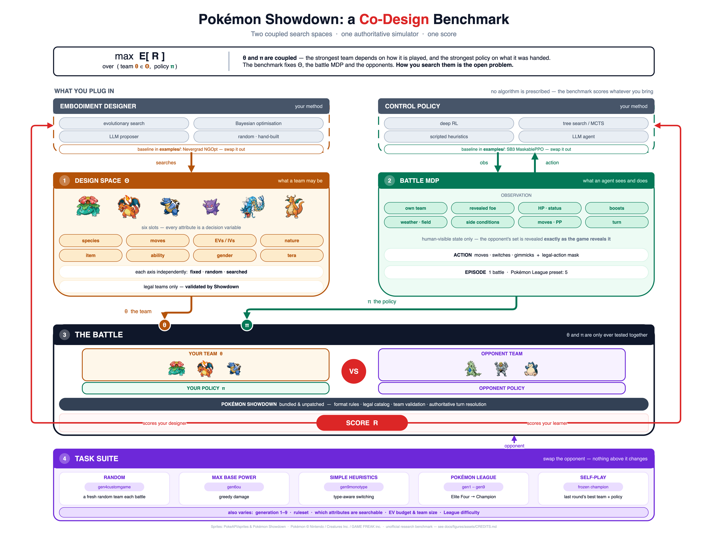
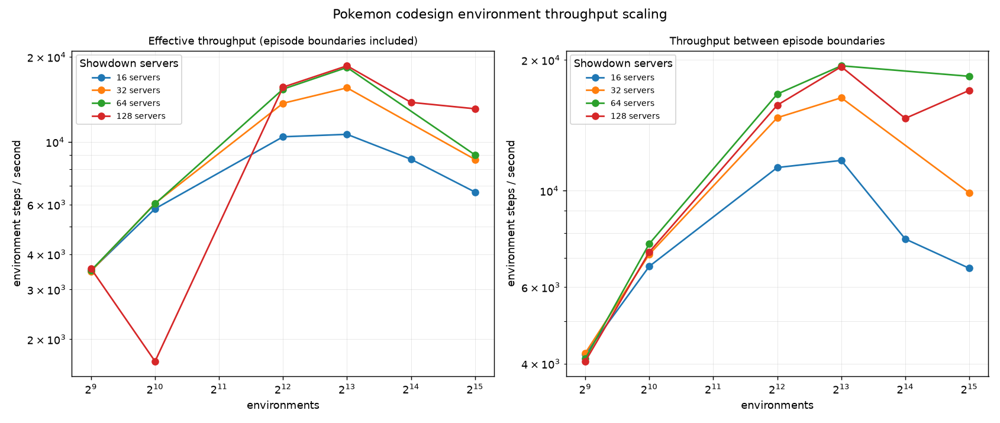

# Pokémon Showdown Co-design Environment

<p align="center">
  
</p>

You design a Pokémon team (the **design**, or *embodiment*) and train a policy to battle with it (the **control policy**).
Each battle returns one reward for the pair. Since the best team depends on how it is played, and the best policy on the team it is given, the two have to be optimized together.

Battles run on an unmodified [Pokémon Showdown](https://github.com/smogon/pokemon-showdown) through [poke-env](https://github.com/hsahovic/poke-env), so team legality and turn resolution are the real game's.
The bundled examples (Nevergrad NGOpt + SB3 MaskablePPO) are baselines to replace with your own methods.

To use this environment through Codesign Gym, see the [Codesign Gym Pokémon README](https://github.com/camral/codesign-gym/blob/main/src/envs/pokenv/README.md).

## Install

You need Python 3.11 or later and Node.js 22 or later (with `npm`).

```bash
git clone --recurse-submodules https://github.com/camral/pokemon-codesign-env
cd pokemon-codesign-env
npm --prefix pokemon-showdown ci
pip install -e '.[rl]'                                  # use '.' without the examples
pokemon-codesign-install-showdown pokemon-showdown      # adds the League formats and builds the server
```

The last command adds the League formats through Showdown's `config/custom-formats.ts`, leaving the simulator untouched. If you already have custom formats, it keeps them and tells you which import to add.

## Quick start

```python
import numpy as np
import pokemon_codesign_env as pce
from pokemon_codesign_env.configs import AttributeMode, FormatConfig, SelectionMode, TeamSearchConfig

if __name__ == "__main__":          # required: the env starts worker processes
    config = TeamSearchConfig(format=FormatConfig.from_showdown("gen4customgame"), team_size=6,
                              species=SelectionMode.OPTIMIZED, natures=AttributeMode.OPTIMIZED)
    env, base = pce.make("random", embodiment_config=config)
    design = env.embodiment_space.sample()
    obs, info, rejected = env.reset(seed=0, embodiment=design)
    if not rejected.any():
        action = np.flatnonzero(obs["action_mask"])[0]
        obs, reward, terminated, truncated, info = env.step(action)
    env.close()
```

- Keep the `if __name__ == "__main__":` guard; without it, `make` fails to start its workers.
- The env starts its own Showdown servers and stops them on `close()`.
- `reset` returns `(obs, info, rejected)` here, but `(obs, rejected, info)` through Codesign Gym.
- Without `embodiment_config`, nothing is designed and the design is `{}`.

The full API (design space, rejection, flat vectors, vector envs, seeds) is in [docs/codesign_gym_api.md](docs/codesign_gym_api.md).

## Tasks

| `opponent` | Opponent | Format |
|---|---|---|
| `random` | Picks a random legal move, switching 20% of the time. | Gen 4 |
| `max_base_power` | Always picks its highest base-power move. | Gen 6 |
| `simple_heuristics` | poke-env's heuristic player. | Gen 9 |
| `league` | One generation's Elite Four and Champion in a row; a loss ends the episode. | Gen 1–9 |

The first three opponents field a new random team every battle. League options (generation, difficulty, random League) are in [envs/README.md](src/pokemon_codesign_env/envs/README.md).

## Examples

The examples need the `rl` extra and default to the CPU with one environment.

Train a team (NGOpt) and a policy (PPO) together:

```bash
python examples/train_sb3_ngopt.py --ppo-timesteps 2048 --evaluation-episodes 8 --verbose
python examples/train_sb3_ngopt.py --environment max-base-power      # or simple-heuristics
```

NGOpt picks the species and nature of all six Pokémon, giving each environment its own team, and scores and replaces the whole population after every PPO rollout. The best team and policy are saved to `runs/minimal_codesign/`.

Train on the League:

```bash
python examples/train_pokemon_league_sb3_ngopt.py --generation 4 --difficulty 0 --verbose
python examples/train_pokemon_league_sb3_ngopt.py --random-league --difficulty 0
```

Useful options:

| Option | Use |
|---|---|
| `--device cuda:N` | Train on a GPU (`--device auto` uses CUDA when available). |
| `--num-envs N --vec-env subproc` | Run N environments in separate processes. |
| `--num-envs N --vec-env sharded --envs-per-worker 32` | Run hundreds or thousands of environments. |
| `--progress` | Show a progress bar with FPS. |
| `--wandb-project P --wandb-entity E` | Log to W&B (`--wandb-mode offline` or `disabled` to skip uploading). |

Example GPU run:

```bash
python examples/train_sb3_ngopt.py --device cuda:0 --num-envs 1024 --vec-env sharded --envs-per-worker 32 \
  --rollout-steps 32 --batch-size 8192 --ppo-timesteps 1048576 --progress
```

### Watch a trained policy

`--watch` plays on a local Showdown server, so start one in another terminal:

```bash
node pokemon-showdown/pokemon-showdown start --no-security
```

Then open `http://localhost:8000` and rerun your training command with `--watch`:

```bash
python examples/train_sb3_ngopt.py --watch --watch-games 3 --turn-delay 1
python examples/train_pokemon_league_sb3_ngopt.py --generation 4 --difficulty 0 --watch --turn-delay 1
```

The script prints a link to each battle and saves HTML replays in `runs/<experiment>/replays/`.

## Performance

Simulation is CPU-only, so throughput scales with cores. Measured on 2 × AMD EPYC 9555 (64 cores each):

<p align="center">
  
</p>

Each Showdown shard keeps a runtime folder in `/tmp`, removed on close. To put them on a larger disk:

```bash
export POKEMON_SHOWDOWN_RUNTIME_DIR=/local_nvme/$USER/pokemon-showdown
```

## Figures

The figure source is [`docs/figures/codesign.drawio`](docs/figures/codesign.drawio); rebuild it with `python docs/figures/build_figure.py` and export with the draw.io CLI.
Sprite credits are in [`docs/figures/assets/CREDITS.md`](docs/figures/assets/CREDITS.md).
